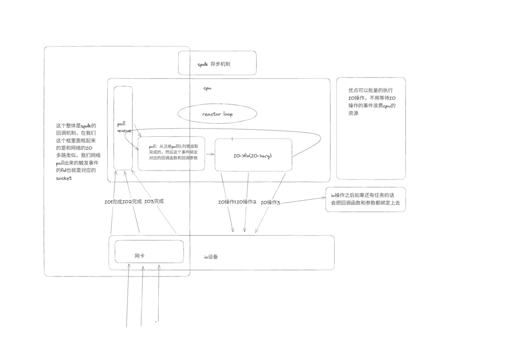

# 了解整个的存储体系

# 认识spdk
## nvme bdev blob blobstore channel


## spdk提供的是一种异步回调的机制
## posix提供的是一种同步的机制
## fd的定义和机制的实现

# 理清基础代码

## setup
1. 这里干了几件事，配置opts，配置log日志，创建局线程，loadjson
2. 这里比较难理解的就是opt是啥，还有就是我们的json是啥
3. opt干了啥，初始化了一些spdk的选项
4. json配置了啥，这个没有看懂
## 我们的所有spdk的接口代码都是回调吗，我们这里真的需要回调吗

1. 来看一下我的理解，首先如果是纯start，那就是一直回调，这里回调是啥呢，就是我使用一个spdk的接口，然后会让我输入一个函数指针和函数参数，这个就是我们这个函数执行完之后然后回调的下一个函数，这里真的是异步吗，为啥spdk要这样设计，我们执行完回到我们之前这个函数不行吗

2. 首先我们来看没有异步改同步，光异步的版本，我们的流程是在start里面调entry，然后entry里面回调open，然后open里面回调write，然后write里面回调read，read里面回调close，你说是异步的，那步骤就是我们在entry执行函spdk函数，然后立刻返回，真正在另一个线程里面执行，然后另一个线程执行完之后，然后会回调我们的open操作，我们写的函数，这样写其实就是串行执行的，不信你看，我每次cb都是在一个函数的末尾执行的，所以我一个函数执行到回调之后就结束了，那就是我entry执行我写的函数，然后到回调，去另一个线程执行spdk的代码，然后我们当前的函数已经执行完了，然后我们要等到spdk执行完，才会调用我们的线程的open的函数，如果我们想要真的提高性能，那就要在我们调用回调函数之后再执行，不依赖于上面回调函数的代码，不然回调里面的创建线程，销毁线程其实是没有必要的开销

## spdk里面的loop和异步的执行



1. 那就是首先loop，然后poll查看有没有事件完成，然后调用完成事件的回调函数，然后回调函数里面有spdk相关的回调函数的话会执行cpu相关的，io事件提交完之后注册poll，然后完成下面的代码，然后执行完回到loop，然后poll一下，看一下提交的io事件完成没有，完成了就调用回调函数
2. 那我们执行回调的时候就要想了，我们啥时候执行回调，为啥我们这里会出现回调嵌套的问题，归根结底就是因为依赖，我们的每一个下一个回调函数会依赖上一个回调函数的结果，就像write依赖open，read依赖write，我们的异步回调解决的是IO的等待时间，我们可以专注于完成cpu的任务，但是现在我们如果实现接口的时候把异步变同步会产生啥结果，按照我们的代码，异步改同步，我们使用同步的接口的时候肯定是一步依赖一步的，我们把app改成env我们改变了啥呢，如果我们想以前app一样有loop的话，那就是改同步会有很多cpu空转，那env解决了哪些问题呢

## 从异步到同步
### 从app到env
1. 在我们的app里面，是先进行env_int然后进入loop_run然后我们以后这个reactor就会一直循环poll，调用回调函数，然后再循环，如果我们把app从异步改成同步，按道理来说也是可以写的，需要我们在另开一个线程，然后执行这个reactorloop，然后我们在这个接口层调用接口的时候就是想这个poll投递函数事件，然后在这个reactor里面执行，这样在我们不想这个reactor投递的时候就会出现reator空转消耗cpu的状况
2. 然后我们现在是干啥呢，我们另开一个线程，然后当我们需要调用回调函数的时候，我们一个线程执行函数操作，等待cpu运行和io运行结束，然后另一个线程while空转检查这个操作是否运行结束
3. 但是这样就有一个问题，如果我们是同步的，为啥spdk只提供异步的调用方案，或者说，我们一般不使用spdk从异步改同步，spdk的异步决定它可以批量的操作，但是改成同步的，串行的，而且我们需要自己消耗cpu判断是否异步事件结束，如果是原生的同步，不是异步改同步，IO操作的时候都需要等，但是异步改同步会消耗cpu资源


## 了解之后我们我们需要做的是先把这个的基础版代码实现
1. 实现file->fd的映射于fd的管理
2. 完成简单语义纠正
3. 完成mount，open，write，read，close，unmount的hook与接口的LD_PRELOAD成功运行简单的文件读写demo


### fd

1. 首先来看fd如何设计，我们之前的dpdk里面我们的项目里面的fd就是每次按位图分配和归还，然后我们在shim的时候通过设置偏移来和我们实际项目有的使用我们fd有的使用内核的fd分开，这样的设计对吗，我们在这里还使用这个方法吗，有没有更好的方法，之前我们实现dpdk的时候由于这个fd我们经常把内核的我们的搞混，而且后面我们管理也特别费劲，这里我想的是我们直接全部使用内核的fd，这样就不会和内核的fd产生冲突，我们也不用管理，使用eventfd获得fd
2. 


# 完成第一版需求
1. opendir seekposixaip接口的实现
2. 用fio可以测试spdk的性能
3. 编译成一个动态库.so
4. 把rockdb，用ld跑
5. 把postgreensql跑到上面
6. fastdfs跑到上面


初始化成功之后，我们一个全流程跑通了，我们的需求开始了，首先接口老师没有明确说，那就再跑程序时候看程序需要哪个接口，我们实现哪个接口，动态库我们已经编译过了，接下来就是fio，
# 实现步骤
1. 下载好这些软件之后，我们就要开始实现具体代码了，首先我们需要干啥，就是把我们的


# 接口实现


## lseek、pread、pwrite

## stat、`fstat`、`access`


## mkdir、`opendir`、`readdir`、`closedir`


## 	rename、`unlink`、`truncate/ftruncate`

## fsync、`fdatasync`

## fcntl 的文件加锁和解锁


# fio

这里我们使用fio测的时候引擎使用的sync这个同步引擎

## fio的可选引擎
### sync
这里这个就是fio跑我们的.so库的时候，使用的同步引擎


### fsync
### io_uring
### bdev
### nvme

## 需要我们实现的接口


### open64
#### 这个open64和open的区别就是open支持大文件，这里我们来了解一下这个open
1. 三个参数，第一个是文件的路径和名称，后面一个是flags，一个是mode，flags决定怎样打开文件，mode决定打开我们新建文件的权限
2. flags里面常用的宏
```shell

O_RDONLY    只读
O_WRONLY    只写
O_RDWR      可读可写
O_CREAT     文件不存在时创建
O_CLOEXEC   在执行exec时候，新程序自动关闭fd
O_LARGEFILE 大文件支持标志
O_TMPFILE   在指定的目录中创建一个暂时没有名字的普通文件
O_APPEND    每次都写入到文件末尾
```
3. mode的选择
```shell
0     6       4       4
八进制 所有者   所属组   其他用户
      读+写    只读     只读

```
每组权限中
- 读：4
- 写：2
- 执行：1


### lseek
1. 首先要偏移，我们首先要记录偏移，然后fio里面通过lseek来控制偏移,首先就是给我的文件结构体添加一个偏移位，然后我们是想lseek的时候就是设置这个offset偏移字段，实现之后就是更改我们的读和写
2. 首先就是我们读和写的时候调用的spdk的spdk_blob_io_read/spdk_blob_io_write这里面有一个设置偏移的参数，这里每一个偏移单位是我们的文件系统的file->fs->unit_size，所以我们调用spdk_blob_io_write偏移的时候偏移file->offset/file->fs->unit_size然后在我们的write和read里面拷贝和读的时候偏移file->offset%file->fs->unit_size
3. 这里读有一个隐藏的机制，就是我们写的话一次是要把一个unit_size都写进去，如果我们一次只写小于unit_size的大小的数据，会把里面的其他数据覆盖成脏数据，所以这我们写的时候如果小于unitsize的时候需要先把这个unit里面的数据读出来，然后把我们要写的数据复制过去，然后把这一整个unitsize大小的数据写进去


### stat

这个就是查看文件的信息，文件大小，权限，块大小这些

### pread/pwrite

这俩个函数就是lseek->read\write->lseek,然后我们的测试了一下fio使用psync和sync，测试都通过了，但是老师说我们的数据还没有落盘


## 接口实现完之后数据落盘操作
1. 改了一个zvfs.json的设置
2. 改了一下entry里面的名称从Malloc改成Nvme01


## 性能测测试

### 第一次打开页缓存，direct=0
```shell

[global]
ioengine=psync
thread=1
numjobs=1
iodepth=1

filename=a.txt
rw=write
bs=512
size=1m
time_based=1
runtime=30

create_on_open=1
fallocate=none
create_fsync=0
invalidate=0
fadvise_hint=0
direct=0
disk_util=0
unlink=0

group_reporting=1

[write-test]

```
- 走spdk
```shell
gyq2@gyq2:~/spdk/examples/zvfs$ sudo LD_PRELOAD=./libstore.so /home/gyq2/src/fio/fio ./zvfs_sync.fio 
write-test: (g=0): rw=write, bs=(R) 512B-512B, (W) 512B-512B, (T) 512B-512B, ioengine=psync, iodepth=1
fio-3.35
Starting 1 thread
[2026-11-06 04:53:39.178061] nvme_qpair.c: 310:spdk_nvme_qpair_print_command: *NOTICE*: [0000:03:00.0,cntlid:0,qid:0,qpair:0x2000160fbea0,ENABLED] IDENTIFY (06) qid:0 cid:191 nsid:0 cdw10:00000006 cdw11:00000000 PRP1 0x1e6e1d000 PRP2 0x0
[2026-11-06 04:53:39.178230] nvme_qpair.c: 543:spdk_nvme_qpair_print_completion_ext: *NOTICE*: [0000:03:00.0,cntlid:0,qid:0,qpair:0x2000160fbea0,ENABLED] INVALID FIELD (00/02) qid:0 cid:191 cdw0:00000000 sqhd:0007 p:1 m:0 dnr:0
Jobs: 1 (f=1): [W(1)][100.0%][w=5296KiB/s][w=10.6k IOPS][eta 00m:00s]
write-test: (groupid=0, jobs=1): err= 0: pid=5970: Fri Nov  6 04:54:08 2026
  write: IOPS=10.6k, BW=5300KiB/s (5427kB/s)(155MiB/30001msec); 0 zone resets
    clat (usec): min=43, max=4254, avg=92.00, stdev=34.93
     lat (usec): min=43, max=4254, avg=92.21, stdev=34.95
    clat percentiles (usec):
     |  1.00th=[   69],  5.00th=[   75], 10.00th=[   76], 20.00th=[   80],
     | 30.00th=[   81], 40.00th=[   81], 50.00th=[   82], 60.00th=[   83],
     | 70.00th=[   85], 80.00th=[   94], 90.00th=[  118], 95.00th=[  157],
     | 99.00th=[  233], 99.50th=[  269], 99.90th=[  383], 99.95th=[  437],
     | 99.99th=[  766]
   bw (  KiB/s): min= 2164, max= 5480, per=100.00%, avg=5306.24, stdev=435.39, samples=59
   iops        : min= 4328, max=10960, avg=10612.49, stdev=870.75, samples=59
  lat (usec)   : 50=0.07%, 100=84.15%, 250=15.09%, 500=0.66%, 750=0.02%
  lat (usec)   : 1000=0.01%
  lat (msec)   : 2=0.01%, 4=0.01%, 10=0.01%
  cpu          : usr=99.24%, sys=0.34%, ctx=192, majf=1, minf=2370
  IO depths    : 1=100.0%, 2=0.0%, 4=0.0%, 8=0.0%, 16=0.0%, 32=0.0%, >=64=0.0%
     submit    : 0=0.0%, 4=100.0%, 8=0.0%, 16=0.0%, 32=0.0%, 64=0.0%, >=64=0.0%
     complete  : 0=0.0%, 4=100.0%, 8=0.0%, 16=0.0%, 32=0.0%, 64=0.0%, >=64=0.0%
     issued rwts: total=0,318022,0,0 short=0,0,0,0 dropped=0,0,0,0
     latency   : target=0, window=0, percentile=100.00%, depth=1

Run status group 0 (all jobs):
  WRITE: bw=5300KiB/s (5427kB/s), 5300KiB/s-5300KiB/s (5427kB/s-5427kB/s), io=155MiB (163MB), run=30001-30001msec

```
- 走内核的文件系统
```shell
gyq2@gyq2:~/spdk/examples/zvfs$ /home/gyq2/src/fio/fio ./zvfs_sync.fio
write-test: (g=0): rw=write, bs=(R) 512B-512B, (W) 512B-512B, (T) 512B-512B, ioengine=psync, iodepth=1
fio-3.35
Starting 1 thread
Jobs: 1 (f=1): [W(1)][100.0%][w=187MiB/s][w=383k IOPS][eta 00m:00s]
write-test: (groupid=0, jobs=1): err= 0: pid=6280: Fri Nov  6 04:59:26 2026
  write: IOPS=396k, BW=193MiB/s (203MB/s)(5804MiB/30000msec); 0 zone resets
    clat (nsec): min=1763, max=1117.9k, avg=2302.43, stdev=3033.93
     lat (nsec): min=1793, max=1117.9k, avg=2340.13, stdev=3060.32
    clat percentiles (nsec):
     |  1.00th=[  1832],  5.00th=[  1848], 10.00th=[  1864], 20.00th=[  1896],
     | 30.00th=[  1928], 40.00th=[  1960], 50.00th=[  2040], 60.00th=[  2320],
     | 70.00th=[  2384], 80.00th=[  2448], 90.00th=[  2576], 95.00th=[  2768],
     | 99.00th=[  4320], 99.50th=[  5088], 99.90th=[ 25984], 99.95th=[ 74240],
     | 99.99th=[119296]
   bw (  KiB/s): min=180522, max=210104, per=100.00%, avg=198312.42, stdev=7986.32, samples=59
   iops        : min=361045, max=420208, avg=396625.17, stdev=15972.53, samples=59
  lat (usec)   : 2=46.93%, 4=51.78%, 10=1.05%, 20=0.09%, 50=0.07%
  lat (usec)   : 100=0.06%, 250=0.01%, 500=0.01%, 750=0.01%, 1000=0.01%
  lat (msec)   : 2=0.01%
  cpu          : usr=26.21%, sys=73.75%, ctx=162, majf=0, minf=0
  IO depths    : 1=100.0%, 2=0.0%, 4=0.0%, 8=0.0%, 16=0.0%, 32=0.0%, >=64=0.0%
     submit    : 0=0.0%, 4=100.0%, 8=0.0%, 16=0.0%, 32=0.0%, 64=0.0%, >=64=0.0%
     complete  : 0=0.0%, 4=100.0%, 8=0.0%, 16=0.0%, 32=0.0%, 64=0.0%, >=64=0.0%
     issued rwts: total=0,11885937,0,0 short=0,0,0,0 dropped=0,0,0,0
     latency   : target=0, window=0, percentile=100.00%, depth=1

Run status group 0 (all jobs):
  WRITE: bw=193MiB/s (203MB/s), 193MiB/s-193MiB/s (203MB/s-203MB/s), io=5804MiB (6086MB), run=30000-30000msec
```
### 第二次关闭内核的页缓存，direct=1
```shell

[global]
ioengine=psync
thread=1
numjobs=1
iodepth=1

filename=a.txt
rw=write
bs=512
size=1m
time_based=1
runtime=30

create_on_open=1
fallocate=none
create_fsync=0
invalidate=0
fadvise_hint=0
direct=1
disk_util=0
unlink=0

group_reporting=1

[write-test]

```
- 走spdk
```shell
gyq2@gyq2:~/spdk/examples/zvfs$ sudo LD_PRELOAD=./libstore.so /home/gyq2/src/fio/fio ./zvfs_sync.fio 
write-test: (g=0): rw=write, bs=(R) 512B-512B, (W) 512B-512B, (T) 512B-512B, ioengine=psync, iodepth=1
fio-3.35
Starting 1 thread
[2026-11-06 05:02:50.143396] nvme_qpair.c: 310:spdk_nvme_qpair_print_command: *NOTICE*: [0000:03:00.0,cntlid:0,qid:0,qpair:0x2000160fbea0,ENABLED] IDENTIFY (06) qid:0 cid:191 nsid:0 cdw10:00000006 cdw11:00000000 PRP1 0x1e6e1d000 PRP2 0x0
[2026-11-06 05:02:50.143555] nvme_qpair.c: 543:spdk_nvme_qpair_print_completion_ext: *NOTICE*: [0000:03:00.0,cntlid:0,qid:0,qpair:0x2000160fbea0,ENABLED] INVALID FIELD (00/02) qid:0 cid:191 cdw0:00000000 sqhd:0007 p:1 m:0 dnr:0
Jobs: 1 (f=1): [W(1)][100.0%][w=5233KiB/s][w=10.5k IOPS][eta 00m:00s]
write-test: (groupid=0, jobs=1): err= 0: pid=6665: Fri Nov  6 05:03:19 2026
  write: IOPS=10.1k, BW=5033KiB/s (5153kB/s)(147MiB/30001msec); 0 zone resets
    clat (usec): min=43, max=1562, avg=96.97, stdev=43.32
     lat (usec): min=44, max=1563, avg=97.17, stdev=43.34
    clat percentiles (usec):
     |  1.00th=[   57],  5.00th=[   74], 10.00th=[   76], 20.00th=[   80],
     | 30.00th=[   81], 40.00th=[   82], 50.00th=[   83], 60.00th=[   85],
     | 70.00th=[   91], 80.00th=[  103], 90.00th=[  141], 95.00th=[  176],
     | 99.00th=[  273], 99.50th=[  322], 99.90th=[  486], 99.95th=[  627],
     | 99.99th=[  938]
   bw (  KiB/s): min= 1826, max= 5600, per=100.00%, avg=5035.68, stdev=548.35, samples=59
   iops        : min= 3652, max=11200, avg=10071.39, stdev=1096.68, samples=59
  lat (usec)   : 50=0.24%, 100=78.05%, 250=20.32%, 500=1.31%, 750=0.06%
  lat (usec)   : 1000=0.02%
  lat (msec)   : 2=0.01%
  cpu          : usr=99.22%, sys=0.30%, ctx=440, majf=1, minf=2368
  IO depths    : 1=100.0%, 2=0.0%, 4=0.0%, 8=0.0%, 16=0.0%, 32=0.0%, >=64=0.0%
     submit    : 0=0.0%, 4=100.0%, 8=0.0%, 16=0.0%, 32=0.0%, 64=0.0%, >=64=0.0%
     complete  : 0=0.0%, 4=100.0%, 8=0.0%, 16=0.0%, 32=0.0%, 64=0.0%, >=64=0.0%
     issued rwts: total=0,301962,0,0 short=0,0,0,0 dropped=0,0,0,0
     latency   : target=0, window=0, percentile=100.00%, depth=1

Run status group 0 (all jobs):
  WRITE: bw=5033KiB/s (5153kB/s), 5033KiB/s-5033KiB/s (5153kB/s-5153kB/s), io=147MiB (155MB), run=30001-30001msec
gyq2@gyq2:~/spdk/examples/zvfs$ 
```
- 走内核
```shell

gyq2@gyq2:~/spdk/examples/zvfs$ /home/gyq2/src/fio/fio ./zvfs_sync.fio
write-test: (g=0): rw=write, bs=(R) 512B-512B, (W) 512B-512B, (T) 512B-512B, ioengine=psync, iodepth=1
fio-3.35
Starting 1 thread
Jobs: 1 (f=1): [W(1)][100.0%][w=1651KiB/s][w=3302 IOPS][eta 00m:00s]
write-test: (groupid=0, jobs=1): err= 0: pid=6517: Fri Nov  6 05:02:32 2026
  write: IOPS=3244, BW=1622KiB/s (1661kB/s)(47.5MiB/30001msec); 0 zone resets
    clat (usec): min=140, max=2958, avg=306.30, stdev=94.04
     lat (usec): min=140, max=2959, avg=306.61, stdev=94.06
    clat percentiles (usec):
     |  1.00th=[  215],  5.00th=[  231], 10.00th=[  237], 20.00th=[  247],
     | 30.00th=[  255], 40.00th=[  265], 50.00th=[  273], 60.00th=[  285],
     | 70.00th=[  306], 80.00th=[  351], 90.00th=[  437], 95.00th=[  494],
     | 99.00th=[  644], 99.50th=[  725], 99.90th=[  963], 99.95th=[ 1123],
     | 99.99th=[ 1516]
   bw (  KiB/s): min= 1397, max= 1761, per=100.00%, avg=1623.32, stdev=81.32, samples=59
   iops        : min= 2794, max= 3522, avg=3246.93, stdev=162.66, samples=59
  lat (usec)   : 250=23.87%, 500=71.38%, 750=4.34%, 1000=0.32%
  lat (msec)   : 2=0.08%, 4=0.01%
  cpu          : usr=2.08%, sys=35.14%, ctx=97286, majf=0, minf=0
  IO depths    : 1=100.0%, 2=0.0%, 4=0.0%, 8=0.0%, 16=0.0%, 32=0.0%, >=64=0.0%
     submit    : 0=0.0%, 4=100.0%, 8=0.0%, 16=0.0%, 32=0.0%, 64=0.0%, >=64=0.0%
     complete  : 0=0.0%, 4=100.0%, 8=0.0%, 16=0.0%, 32=0.0%, 64=0.0%, >=64=0.0%
     issued rwts: total=0,97324,0,0 short=0,0,0,0 dropped=0,0,0,0
     latency   : target=0, window=0, percentile=100.00%, depth=1

Run status group 0 (all jobs):
  WRITE: bw=1622KiB/s (1661kB/s), 1622KiB/s-1622KiB/s (1661kB/s-1661kB/s), io=47.5MiB (49.8MB), run=30001-30001msec
```

