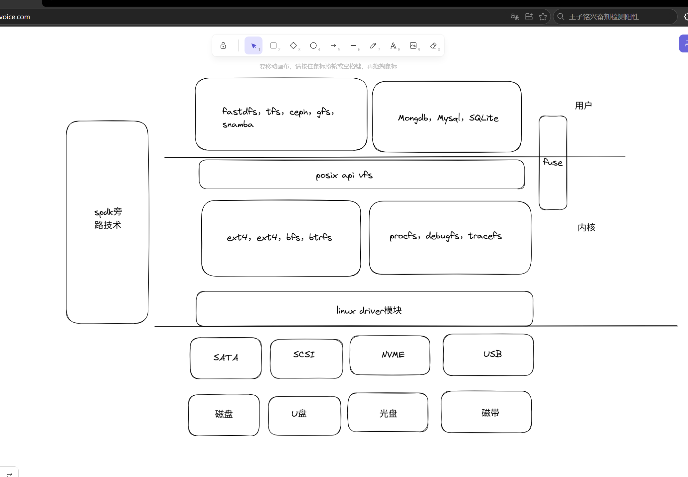

# 了解整个的存储体系

# 认识spdk
## nvme bdev blob blobstore channel

## spdk提供的是一种异步回调的机制
## posix提供的是一种同步的机制
## fd的定义和机制的实现

# 理清基础代码

## setup
1. 这里干了几件事，配置opts，配置log日志，创建局线程，loadjson
2. 这里比较难理解的就是opt是啥，还有就是我们的json是啥
3. opt干了啥，初始化了一些spdk的选项
4. json配置了啥，这个没有看懂
## 我们的所有spdk的接口代码都是回调吗，我们这里真的需要回调吗

1. 来看一下我的理解，首先如果是纯start，那就是一直回调，这里回调是啥呢，就是我使用一个spdk的接口，然后会让我输入一个函数指针和函数参数，这个就是我们这个函数执行完之后然后回调的下一个函数，这里真的是异步吗，为啥spdk要这样设计，我们执行完回到我们之前这个函数不行吗

2. 首先我们来看没有异步改同步，光异步的版本，我们的流程是在start里面调entry，然后entry里面回调open，然后open里面回调write，然后write里面回调read，read里面回调close，你说是异步的，那步骤就是我们在entry执行函spdk函数，然后立刻返回，真正在另一个线程里面执行，然后另一个线程执行完之后，然后会回调我们的open操作，我们写的函数，这样写其实就是串行执行的，不信你看，我每次cb都是在一个函数的末尾执行的，所以我一个函数执行到回调之后就结束了，那就是我entry执行我写的函数，然后到回调，去另一个线程执行spdk的代码，然后我们当前的函数已经执行完了，然后我们要等到spdk执行完，才会调用我们的线程的open的函数，如果我们想要真的提高性能，那就要在我们调用回调函数之后再执行，不依赖于上面回调函数的代码，不然回调里面的创建线程，销毁线程其实是没有必要的开销

## spdk里面的loop和异步的执行

1. 那就是首先loop，然后poll查看有没有事件完成，然后调用完成事件的回调函数，然后回调函数里面有spdk相关的回调函数的话会执行cpu相关的，io事件提交完之后注册poll，然后完成下面的代码，然后执行完回到loop，然后poll一下，看一下提交的io事件完成没有，完成了就调用回调函数
2. 那我们执行回调的时候就要想了，我们啥时候执行回调，为啥我们这里会出现回调嵌套的问题，归根结底就是因为依赖，我们的每一个下一个回调函数会依赖上一个回调函数的结果，就像write依赖open，read依赖write，我们的异步回调解决的是IO的等待时间，我们可以专注于完成cpu的任务，但是现在我们如果实现接口的时候把异步变同步会产生啥结果，按照我们的代码，异步改同步，我们使用同步的接口的时候肯定是一步依赖一步的，我们把app改成env我们改变了啥呢，如果我们想以前app一样有loop的话，那就是改同步会有很多cpu空转，那env解决了哪些问题呢

## 从异步到同步
### 从app到env
1. 在我们的app里面，是先进行env_int然后进入loop_run然后我们以后这个reactor就会一直循环poll，调用回调函数，然后再循环，如果我们把app从异步改成同步，按道理来说也是可以写的，需要我们在另开一个线程，然后执行这个reactorloop，然后我们在这个接口层调用接口的时候就是想这个poll投递函数事件，然后在这个reactor里面执行，这样在我们不想这个reactor投递的时候就会出现reator空转消耗cpu的状况
2. 然后我们现在是干啥呢，我们另开一个线程，然后当我们需要调用回调函数的时候，我们一个线程执行函数操作，等待cpu运行和io运行结束，然后另一个线程while空转检查这个操作是否运行结束
3. 但是这样就有一个问题，如果我们是同步的，为啥spdk只提供异步的调用方案，或者说，我们一般不使用spdk从异步改同步，spdk的异步决定它可以批量的操作，但是改成同步的，串行的，而且我们需要自己消耗cpu判断是否异步事件结束，如果是原生的同步，不是异步改同步，IO操作的时候都需要等，但是异步改同步会消耗cpu资源

## 了解之后我们我们需要做的是先把这个的基础版代码实现
1. 实现file->fd的映射于fd的管理
2. 完成简单语义纠正
3. 完成mount，open，write，read，close，unmount的hook与接口的LD_PRELOAD成功运行简单的文件读写demo

### fd

1. 首先来看fd如何设计，我们之前的dpdk里面我们的项目里面的fd就是每次按位图分配和归还，然后我们在shim的时候通过设置偏移来和我们实际项目有的使用我们fd有的使用内核的fd分开，这样的设计对吗，我们在这里还使用这个方法吗，有没有更好的方法，之前我们实现dpdk的时候由于这个fd我们经常把内核的我们的搞混，而且后面我们管理也特别费劲，这里我想的是我们直接全部使用内核的fd，这样就不会和内核的fd产生冲突，我们也不用管理，使用eventfd获得fd
2. 

# 完成第一版需求
1. opendir seekposixaip接口的实现
2. 用fio可以测试spdk的性能
3. 编译成一个动态库.so
4. 把rockdb，用ld跑
5. 把postgreensql跑到上面
6. fastdfs跑到上面

# 实现步骤
1. 下载好这些软件之后，我们就要开始实现具体代码了，首先我们需要干啥，就是把我们的

# 接口实现

## lseek、pread、pwrite

## stat、`fstat`、`access`

## mkdir、`opendir`、`readdir`、`closedir`

## 	rename、`unlink`、`truncate/ftruncate`

## fsync、`fdatasync`

## fcntl 的文件加锁和解锁